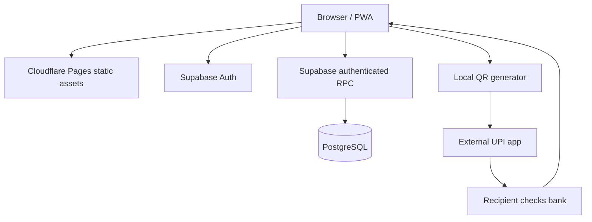

# System architecture
## Runtime

No separate application server. Client uses public project URL/key and authenticated session. PostgreSQL SECURITY DEFINER functions enforce permissions and transactions; tables have RLS enabled and direct access revoked. No service-role key in frontend. Polling refreshes group snapshots every 15 seconds; Realtime is not yet configured.
## Modes
Demo when both environment variables are absent: sample data in browser localStorage, selectable identities, non-payable QR. Connected mode: auth and RPC operations. Never import demo data into live database automatically.
## Repository
src/main.jsx: React UI and client orchestration. src/ledger.mjs: pure calculation functions. src/style.css: responsive styles. supabase/migrations: ordered SQL. tests: node unit and Playwright browser suites. scripts/prepare-pwa.mjs: precache generation. public: manifest, icon, hosting headers/redirects. .github/workflows: CI. capacitor.config.json: packaging settings.
## Decisions
ADR-001: serverless free-tier stack minimizes operational burden. ADR-002: integer paise and deterministic largest remainder allocation. ADR-003: manual recipient confirmation because direct personal UPI payment result is unavailable to site. ADR-004: pairwise balances derived from active expense allocations and confirmed payments; original expense records retained via void/replacement fields. This is not a separate double-entry journal. ADR-005: no caching financial API responses. ADR-006: monolithic frontend initially; modularize before major growth.
## Limitations
Full snapshots and polling scale only to small groups. Introduce pagination and scoped refresh when measured usage requires it. No offline financial writes in connected mode. No automatic bank verification or production observability yet.
